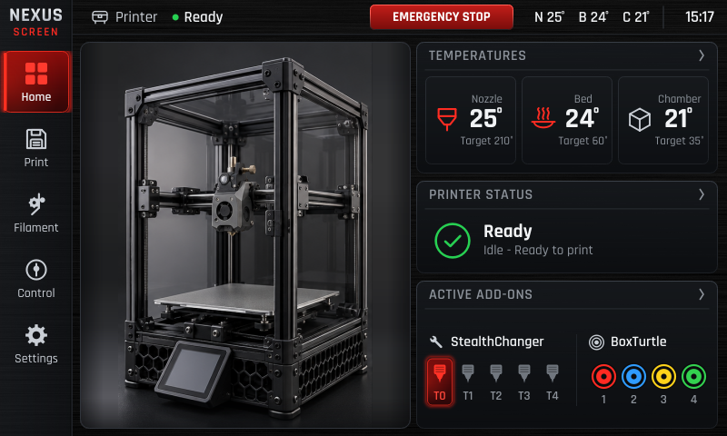
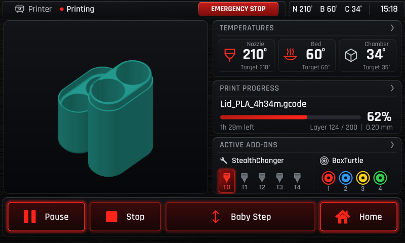
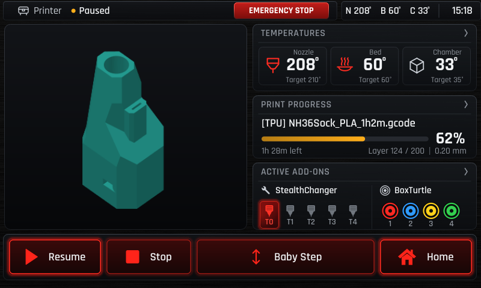
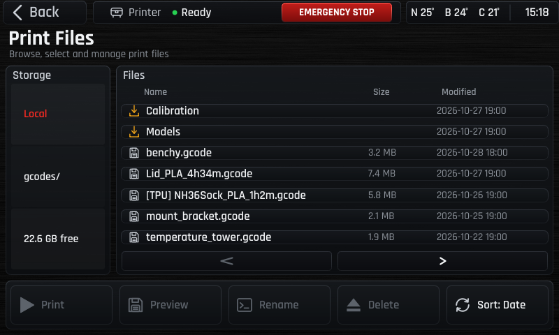
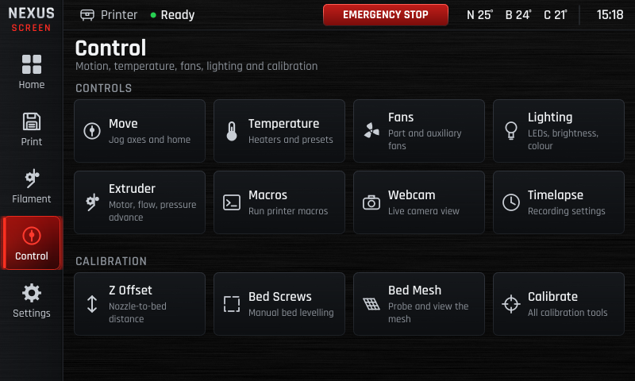
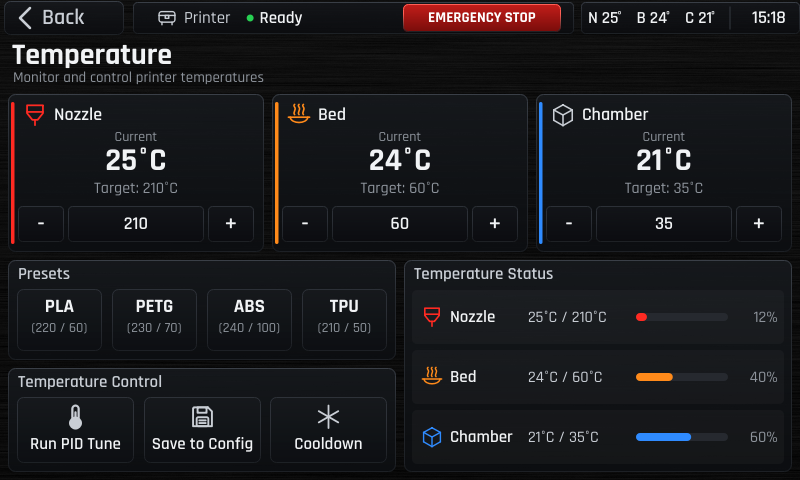
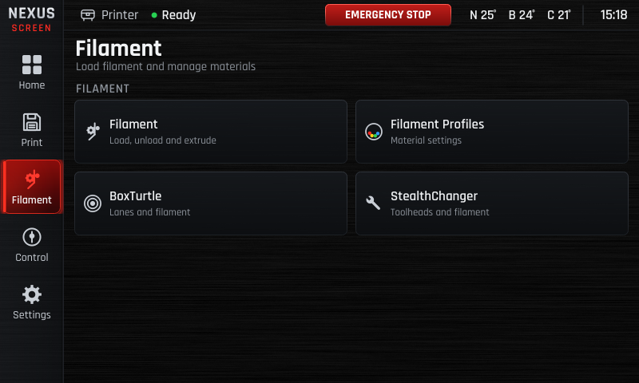
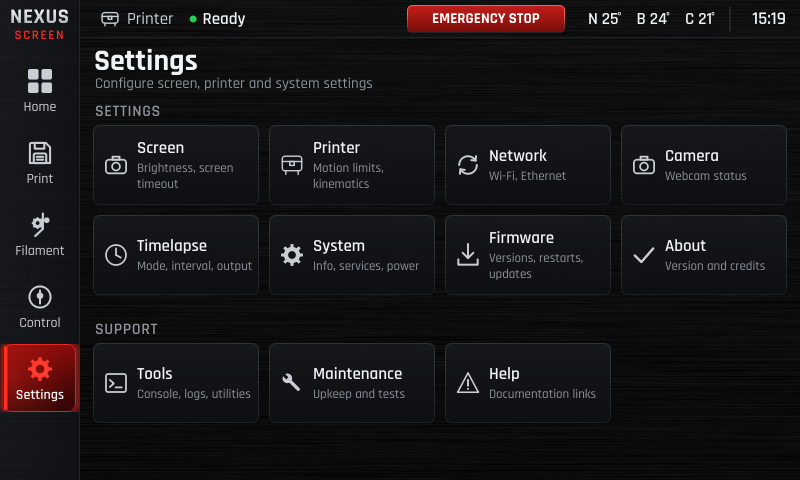

# Nexus Screen

> A cinematic touchscreen interface for Klipper 3D printers.

Nexus Screen is an independent, touch-optimized UI for printers running
[Klipper](https://klipper3d.org) and [Moonraker](https://moonraker.readthedocs.io).
It runs directly on the framebuffer (no desktop environment required) and is
designed for embedded 800×480 DSI touchscreen panels on Raspberry Pi.

**Status: Public Beta — v0.2.0-beta.1**  
See [Beta Limitations](#beta-limitations) before installing.

---

## Screenshots

| | |
|:---:|:---:|
|  |  |
| *Home — temperatures, printer status, and active add-ons* | *Print Status — live thumbnail, progress bar, and print controls* |
|  |  |
| *Print paused — Baby Step Z offset adjustment* | *Print Files — file browser with gcode thumbnails* |
|  |  |
| *Control — motion, temperature, fans, lighting, and calibration* | *Temperature — live heater tiles with numeric keypad* |
|  |  |
| *Filament — load, profiles, BoxTurtle, and StealthChanger* | *Settings — configuration and tools overview* |

---

## Features

- **Adaptive display scaling** — auto-detects framebuffer resolution at startup; scales all layouts, fonts, and touch targets to fit; identity at 800×480
- **5 main sections** — Home, Print, Filament, Control, Settings
- **34 screens** reachable from a persistent sidebar
- **Print management** — full-screen print status, progress, thumbnail preview, Pause/Resume/Stop, Baby Step Z offset
- **Temperature control** — live heater tiles, numeric keypad, presets
- **Motion control** — Move (XYZ+E), Z Offset, Bed Screws, Bed Mesh visualization
- **Filament management** — filament profiles stored in Moonraker database, heat-then-load workflow
- **Add-on support** — BoxTurtle multi-material unit (AFC), StealthChanger toolchanger
- **Cinematic boot splash** — optional animated intro sequence (separate setup step)
- **Safe command gating** — printer commands (pause, resume, stop, baby step) are only sent when the app runs with `--allow-commands`; read-only mode is the default
- **Crash-safe deployment** — automatic health check and rollback on install failure

---

## Supported Hardware

| Component | Tested configuration |
|---|---|
| Single-board computer | Raspberry Pi 4 (2 GB RAM) |
| Single-board computer | BigTreeTech CB1 (see note below) |
| Operating system | 64-bit Raspberry Pi OS (Debian Bookworm, aarch64) |
| Display | 800×480 DSI touchscreen, `/dev/fb0` framebuffer (recommended) |
| Display | 480×320 DSI touchscreen (CB1 / smaller panels — see note below) |
| Touch input | Capacitive touch via `/dev/input/eventN` |
| Firmware | Klipper + Moonraker on the same host (`localhost:7125`) |

**Note — 800×480 is the recommended reference resolution.** Nexus Screen scales to
fit other resolutions automatically, but smaller panels (480×320 and below) may show
truncated labels and reduced readability on some screens. All primary controls remain
accessible at 480×320. The framebuffer must be 16-bit RGB565 (`bits_per_pixel = 16`).

**All other hardware is untested.** This includes Raspberry Pi 3, Pi 5, Pi Zero 2 W,
HDMI displays, SPI displays, and 32-bit OS images.
Community reports of working or failing configurations are welcome via
[GitHub Issues](https://github.com/omarmunoz5371/Nexus-Screen/issues).

---

## Requirements

- Raspberry Pi 4 or BigTreeTech CB1, 64-bit OS (Bookworm)
- Klipper and Moonraker installed and running
- Python 3.11 or later
- PyQt6 ≥ 6.4 — installed via `apt`:
  ```bash
  sudo apt install python3-pyqt6
  ```
- NumPy — required for the health-check framebuffer read:
  ```bash
  sudo apt install python3-numpy
  # or: ~/nexus-screen-env/bin/pip install numpy
  ```
- A 16-bit RGB565 framebuffer display at `/dev/fb0`

---

## Installation

See **[docs/INSTALLATION.md](docs/INSTALLATION.md)** for full step-by-step instructions.

Quick summary:

```bash
# 1. Clone the repository
git clone https://github.com/omarmunoz5371/Nexus-Screen.git ~/nexus-screen
cd ~/nexus-screen

# 2. Create the Python virtual environment
python3 -m venv ~/nexus-screen-env --system-site-packages

# 3. Dry run (checks everything, makes no changes)
sudo deploy/install.sh

# 4. Install (auto-rollback on failure)
sudo deploy/install.sh --confirm
```

The installer stops and disables KlipperScreen if it is present — the KlipperScreen
installation itself is not removed and can be restored with `deploy/rollback.sh`.

---

## Updating

### Via Moonraker Update Manager (recommended)

Add the following to your `moonraker.conf`, then restart Moonraker:

```ini
[update_manager nexus-screen]
type: git_repo
path: ~/nexus-screen
origin: https://github.com/omarmunoz5371/Nexus-Screen.git
primary_branch: main
is_system_service: False
```

You can then update Nexus Screen from the **Update Manager** panel in Mainsail or Fluidd.
After updating, restart the service:

```bash
sudo systemctl restart nexus-screen
```

### Manual update

```bash
cd ~/nexus-screen
git pull
sudo systemctl restart nexus-screen
```

See [docs/moonraker-update-manager.md](docs/moonraker-update-manager.md) for details.

---

## Uninstalling

See **[docs/UNINSTALL.md](docs/UNINSTALL.md)**.

```bash
# Stop and disable Nexus Screen; restore KlipperScreen to its pre-install state
sudo ~/nexus-screen/deploy/rollback.sh --confirm
```

---

## Troubleshooting

See **[docs/TROUBLESHOOTING.md](docs/TROUBLESHOOTING.md)** for common problems and solutions.

```bash
# Check service status
systemctl status nexus-screen
journalctl -u nexus-screen -b

# Run the built-in health check
~/nexus-screen-env/bin/python ~/nexus-screen/deploy/healthcheck.py
```

---

## Beta Limitations

This is a **public beta**. The following are known limitations in v0.2.0-beta.1:

- **Tested on two hardware configurations** — see [Supported Hardware](#supported-hardware)
- **Adaptive scaling is best-effort on small displays** — 800×480 is the reference resolution; smaller panels (480×320 and below) may show truncated labels on some screens; all primary controls remain accessible
- **Printer commands require explicit opt-in** — enabled separately with `deploy/commands.sh enable`
- **Boot splash requires separate media build** — see `docs/SPLASH.md`; the splash media is not
  distributed in the repository and must be built from the source assets
- **Webcam and Timelapse screens are present but non-functional** — UI placeholder only; no stream or timelapse control in this release
- **Moonraker Update Manager integration is documented but not end-to-end tested** — the verified update path in this release is `git pull` + `sudo systemctl restart nexus-screen`
- **No multi-printer support** — connects to a single Moonraker instance on `localhost:7125`

---

## Bug Reports and Contributing

- **Report a bug:** [Open an issue](https://github.com/omarmunoz5371/Nexus-Screen/issues/new?template=bug_report.yml)
- **Request a feature:** [Open an issue](https://github.com/omarmunoz5371/Nexus-Screen/issues/new?template=feature_request.yml)
- **Contributing:** See [CONTRIBUTING.md](CONTRIBUTING.md)

Include the output of `scripts/bug-report.sh "description of the problem"` with your bug report.

---

## License

Nexus Screen is released under the [GNU General Public License v3.0](LICENSE).

Bundled fonts (Rajdhani) are licensed under the [SIL Open Font License 1.1](https://openfontlicense.org/).
